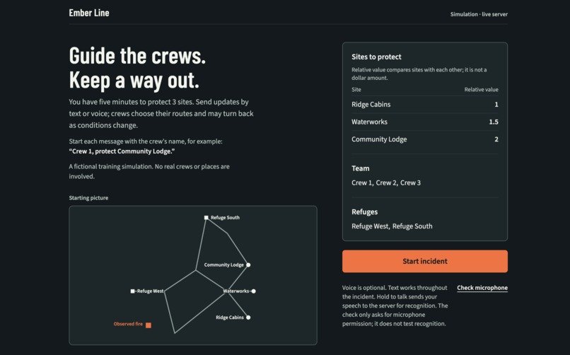
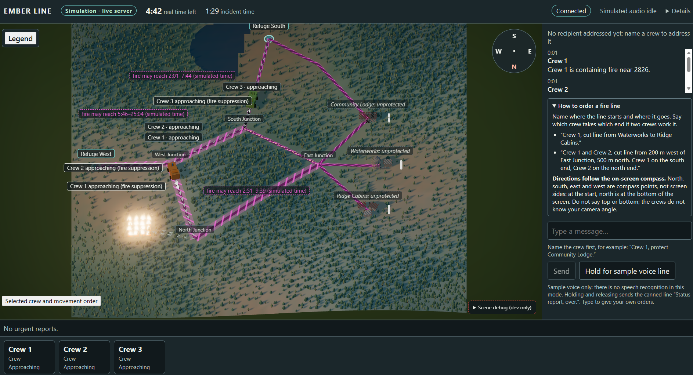
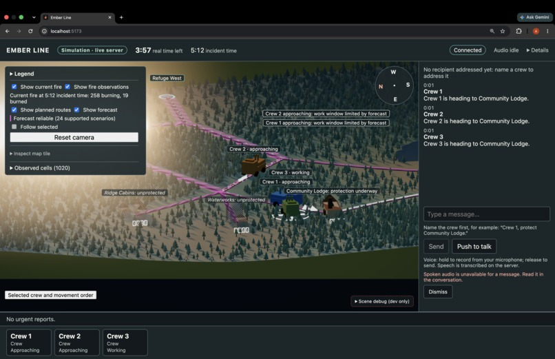
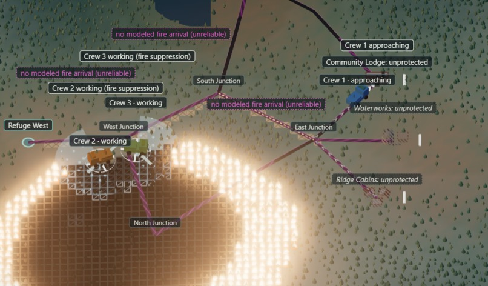
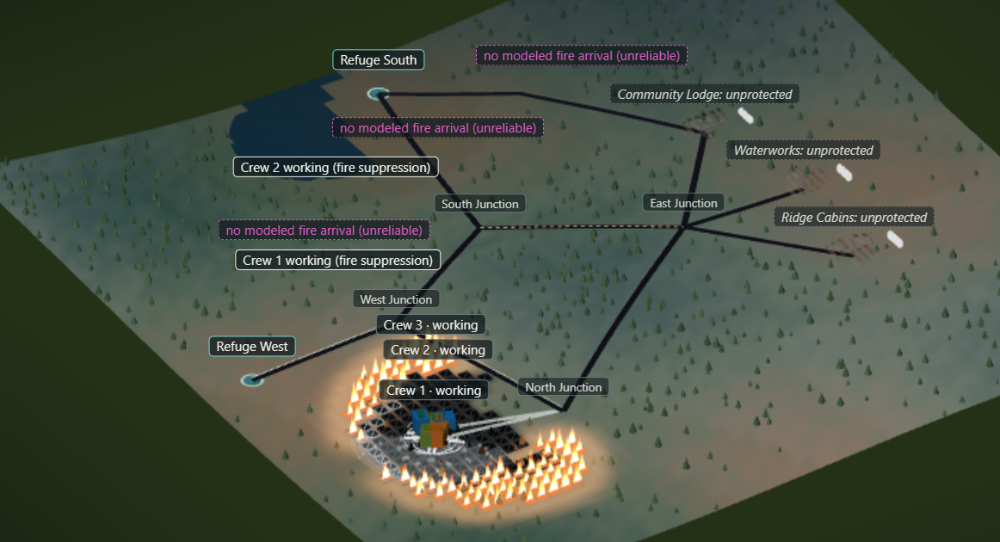
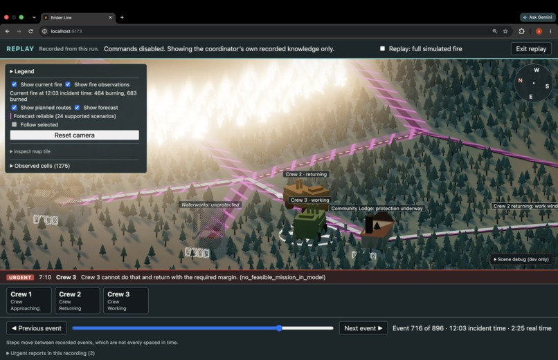

# Ember Line

Ember Line (or Ember) is a real-time wildfire response simulation focused on crew coordination and control, fire forecasting, and safe navigation. A central coordinator (the user) directs multiple crews through an evolving wildfire incident using text or voice commands, while crews plan their own missions and respond to changing conditions.

The project combines a wildfire simulation, per-agent knowledge, forecast ensembles, autonomous navigation, and a Three.js interface. The goal is to explore how crews can coordinate and make safer decisions when information is incomplete or conditions change, while making their decisions and limitations visible.  

Team members: Andrew Zhang, Benjamin Lim, Suhani Aggarwal   
This project was completed as part of the Big Red Hackathon from October 2-4, 2026.  
### >>> [Devpost!](https://devpost.com/software/ember-line)   
### >>> [Video Demo (Youtube)!](https://www.youtube.com/watch?v=gmlscYzSZ3c)   

## Photo Gallery

Here is the landing page, before starting the simulation.  
  

This is the complete UI showing planned routes, the roads, the crews and the fire. Importantly there is a message box on the right where commands are sent to the crews.
  

This is the same display but it highlights camera panning and the speech-to-text integration.  
  

Here is one potential response: Crew 1 built firebreaks from West Junction to South Junction, and from South Junction to East Junction. Meanwhile, Crews 2 and 3 are working to slow the fire down with hoses.   
  

Here is another potential response: No directions were given and the crews all navigated to the fire together. It is about to become dangerous as the fire will surround the three crews. 
  

This is the replay mode that shows after the incident has ended.
  

## Core Capabilities

- **Wildfire Simulation:** Fire spread, changing weather conditions, suppression, and incident outcomes.
- **Forecasting:** Multiple possible fire developments based on available observations, including handling stale or contradictory information.
- **Autonomous Navigation:** Mission planning, route reservations, replanning, and automatic retreat when conditions become unsafe.
- **Crew Coordination:** Multiple crews, shared road access, and independent decision-making based on crew-specific knowledge.
- **Text and Voice Interaction:** Addressed commands, status queries, clarification, and urgent communications.
- **3D Visualization:** Terrain, crews, sites, routes, forecasts, and incident status in a Three.js scene.
- **Replay and Evaluation:** Reproducible scenarios, event logs, and tools for comparing policies and investigating failures.

## Architecture

The project is organized into four main areas:

- **Simulation and Domain:** Incident state, fire behavior, crew state, crew response, and shared contracts.
- **Planning and Intelligence:** Forecasting, agent knowledge, mission selection, and navigation.
- **Server and Communication:** Incident lifecycle, client transport, and voice interaction.
- **Web Application:** Three.js scene, coordinator interface, and replay experience.

The server owns the authoritative simulation state. Crews make decisions using their own available knowledge rather than information that is only available to the coordinator or the full simulation. Replay and evaluation can access the complete incident history.

## Implementation Status

- **Implemented:** Core simulation and replay infrastructure, knowledge and forecasting logic, navigation and autonomy, multi-crew coordination, and the main web scene.
- **Potential Future Work:** Real road-data (Open Street Maps) integration, more varied terrain, full conversation handling in addition to command sending and receipt, rain and planes suppressing the fire with water. 

Type checking, linting, and tests run through GitHub Actions. The simulation and web application have separate test suites. Current test counts and release readiness should be checked against the latest branch and CI results.

## Development Setup

The project uses a pnpm monorepo. See the relevant application or package README for setup and execution instructions.

Useful references:

- [Product specification](EMBER_LINE.md)
- [Server and evaluation](docs/SERVER_AND_EVALUATION.md)
- [Server setup](apps/server/README.md)
- [Simulation design](docs/SIMULATION.md)
- [Navigation and agents](docs/NAVIGATION_AGENTS.md)
- [Validation scenarios](docs/VALIDATION.md)
- [Development log](OVERNIGHT_LOG.md)

Quick start:  
```bash
# Optional segment for Push-to-Talk: 
export XAI_API_KEY="your-xai-api-key"
export XAI_INTENT=1 # optional: uses Grok LLM to interpret speech commands
export VITE_GROK_VOICE=1 # enables live mic recording in the web client
# Then run:
bash scripts/demo.sh
```
The server interface will be running on localhost:5173.

## Implementation Workflow

Development was split into seven workstreams with utilization of GitHub. Work was done on each independently on a branch before sending PRs to main. Quality was ensured via thorough CI testing and review of the changes before merging into main.   
During workstream merging, bugs were reported in GitHub Issues and handled case by case.

### 1. Contract Synchronization (`feat/contract-sync`)

Aligned the domain contracts across the simulation, server, and web client. Added versioned HTTP and voice WebSocket interfaces, backpressure handling, private-state leak tests, and recorded-session fixtures.

This work established the shared contracts used by the other workstreams, particularly for route plans, forecasts, and server communication.

### 2. Fire Simulation (`feat/fire-sim`)

Improved fire behavior with wind changes, spread speed, and other rules. Preserved reproducible runs and benchmarked simulation tick performance. Added fire suppression methods: crews in close proximity to fire spray it with hoses, crews can also construct firebreaks (barrier lines) to contain fire spread. 

### 3. Forecasting (`feat/forecast`)

Expanded forecast ensembles to cover more possible fire developments, including wind shifts, spotting, and moisture changes. Added observation assimilation and per-edge arrival-time ranges, and evaluated calibration against held-out scenarios.

Ensured that empty or contradicted ensembles did not authorize protection work and that dangerous hypotheses were not dropped to improve results.

### 4. Navigation (`feat/navigation`)

Added corridor avoidance, alternative approach roads, replanning at forks, reversal, and partial missions. Improved road reservations and deadlock handling, and added route explanations for the UI.

Added property tests to verify mission feasibility, including that plans with negative safety buffers were never certified.

### 5. Crew Coordination (`feat/crew`)

Added callsigns, independent observations of the fire, and explicit autonomy policies. Improved stale-information recovery and scout value-of-information.

Ensured that crew decisions respected each agent's available knowledge and that coordinator-only observations did not directly change a crew's plan. Crews will only accept the coordinator's directions when they know the proposed action is safe, i.e. it can be completed before the fire is forecast to arrive.

### 6. Three.js Scene (`feat/web-scene`)

Completed the route and forecast layers displaying on the roads. Added terrain, crew and site models, stale-information styling, and camera following.

Connected replay to the server for incident review, and measured frame rate on a documented machine.

### 7. Web Interface (`feat/web-ui`)

Implemented push-to-talk, urgent-audio queuing, transcript handling, clarification, rejected-objective feedback, and status queries. Completed the briefing and debrief flows, accessibility checks, demo mode, and disconnect handling. Included functionality of including XAI_API_KEY environment variable for crew replies becoming text-to-speech.

Added component tests and validated the voice interaction path against the server.

### Integration and Validation

Integrated the workstreams using shared contracts and recorded fixtures. Contract synchronization established the interfaces needed by the scene and web client.

Kept the frontend and backend on the same domain contracts and a single authoritative simulation rather than maintaining separate simulation implementations.

Each workstream included:

- Focused, reviewable changes.
- Automated tests and deterministic fixtures where appropriate.
- A short demonstration of the behavior.
- Performance or evaluation results where relevant.

Type checking, linting, and tests ran through CI. Deterministic invariants were tested before broader randomized evaluation.

### Priorities and Release Criteria

Development prioritized:

1. Simulation correctness and per-agent knowledge.
2. Mission feasibility, safe road coordination, and autonomous retreat.
3. Text and voice interaction.
4. A functional and accessible Three.js interface.
5. Replay, evaluation, performance measurements, and the end-to-end demonstration.

Decorative scene detail and optional evaluation breadth were treated as lower priorities than core behavior and safety checks. Dangerous forecast hypotheses were not silently discarded, infeasible missions were not certified, and crews retained autonomous retreat behavior when a safe return was no longer possible.

Simulation performance, forecast calibration, navigation outcomes, and rendering performance were evaluated using actual runs rather than assumed improvements.

See the implementation plan and validation documentation for detailed tasks, dependencies, and acceptance criteria. Note that small portions of the architecture/feature documentation may be out of sync with the main branch, due to decisions made as work progressed.

## Project Status and Limitations

Ember Line was developed as a prototype, not a validated operational firefighting tool. Synthetic scenarios and scripted integrations supported deterministic development and testing, but did not establish real-world geographic accuracy, live provider readiness, or operational safety.

The project work included validation of the interaction loop, testing against representative scenarios, performance measurements on documented hardware, and an end-to-end demonstration intended to show both the benefits and limitations of autonomous planning.